<!--
  Hey, source explorer 👋
  This is Jayed's actual profile README — original artwork lives in /assets.
  The typing animation and streak widget are third-party images; the banners
  and animated lab console are hosted in this repository.
-->

<div align="center">

  <picture>
    <source media="(prefers-color-scheme: dark)" srcset="assets/hero-dark.svg" />
    <source media="(prefers-color-scheme: light)" srcset="assets/hero-light.svg" />
    
  </picture>

  <a href="https://github.com/Nahian2002">
    
  </a>

  <p>
    <a href="https://www.linkedin.com/in/jayed-al-nahian-2a5ab3248/"></a>
    <a href="https://x.com/Jayed_Al_Nahian"></a>
    <a href="https://www.facebook.com/jayed.al.nahian.2002/"></a>
    <a href="https://discordapp.com/users/743125182889328653"></a>
  </p>

  <sub>📍 Dhaka, Bangladesh &nbsp; • &nbsp; 🎓 CSE @ North South University &nbsp; • &nbsp; ⚡ Always experimenting</sub>

</div>

---

## 👾 Hey there, welcome to my corner of GitHub!

I'm **Jayed Al Nahian** — a curious builder who likes making things work, breaking them by accident, and figuring out how to make them better.

I study **Computer Science & Engineering at North South University**, but plenty of my favorite lessons come from late-night debugging sessions, random software ideas, and asking *“what if I actually built that?”*

- 🔭 **Into:** Android apps, Linux homelabs, automation, AI assistants, and game-world systems
- 🛠️ **Favorite kind of challenge:** Getting an ambitious idea to survive real-world testing
- 🧠 **Learning style:** Build first. Break things. Investigate. Improve.
- 🎮 **Side quests:** Unreal Engine worlds, design experiments, and the occasional completely unnecessary optimization

<div align="center">
  
</div>

## 🪐 What's happening in my lab?

<table>
<tr>
<td width="50%" valign="top">

### 🎧 NightWave
An Android music-app experiment focused on smooth listening, interface polish, library features, and playback.

<sub>Exploring • Private development</sub>

</td>
<td width="50%" valign="top">

### 🤖 COSMO
A desktop-assistant experiment: automation, useful tools, memory concepts, and an interface that feels less like a command line.

<sub>Exploring • Private development</sub>

</td>
</tr>
<tr>
<td width="50%" valign="top">

### 🖥️ HomeLab & Automation
Debian, Docker, media services, monitoring, and little automations that make digital life more interesting.

<sub>Self-hosted • Always tinkering</sub>

</td>
<td width="50%" valign="top">

### 🌌 Worlds & Simulation
Unreal Engine environments, procedural ideas, believable terrain, and worlds with more going on under the surface.

<sub>Unreal Engine • Experimental</sub>

</td>
</tr>
</table>

<details>
<summary><b>🔓 Open the experiment log</b></summary>
<br/>

```text
[JAYED@ENGINEERING-LAB]$ ./status --verbose

[✓] curiosity.exe         RUNNING
[✓] one-more-idea.service ENABLED
[✓] coffee-or-tea        OPTIONAL
[~] bugs                 BEING INVESTIGATED
[∞] projects             ALWAYS EVOLVING

> There is no final build. Only the next iteration.
```

Most personal experiments are private or unfinished. Public links below point to repositories visitors can actually access.

</details>

## 🚀 Projects you can actually explore

These are public repositories — earlier coursework and practical experiments that show part of my coding journey.

| Repository | What you'll find |
| :-- | :-- |
| [**💪 Fitness Tracker — CSE215L**](https://github.com/Nahian2002/Fitness-Tracker---CSE215L) | A Java fitness-tracking coursework project |
| [**⚙️ CSE115L Project**](https://github.com/Nahian2002/CSE-115L-Project) | Early C programming project |
| [**⏰ Automated Reminder**](https://github.com/Nahian2002/Automated-Reminder) | A reminder-related automation experiment |
| [**☕ Learning Java**](https://github.com/Nahian2002/Learning-JAVA) | Code and exercises from learning Java |
| [**🧩 Learning C**](https://github.com/Nahian2002/Learning-C) | Foundations, practice, and experiments in C |

## 🧰 My toolbox

<div align="center">

**Languages & fundamentals**


**Systems & creative playgrounds**


**Design side quests**


</div>

> Tools are things I use or explore — not a claim of mastery.

## ⚡ GitHub activity

<div align="center">

  <a href="https://github.com/Nahian2002">
    
  </a>

  <sub>Live streak card by DemoLab. GitHub's native contribution calendar is also visible below this profile README.</sub>

</div>

<details>
<summary><b>📡 Want more GitHub activity?</b></summary>
<br/>

[**Open my live contribution history ↗**](https://github.com/Nahian2002?tab=overview&from=2026-01-01&to=2026-12-31)

The GitHub contribution calendar and repository activity are the source of truth; third-party cards may update less frequently.

</details>

## ✨ A little more about me

```java
while (curiosity > fearOfBugs) {
    buildSomething();
    learnSomething();
    tryAgain();
}
```

<details>
<summary>🕹️ <b>Bonus: a small developer easter egg</b></summary>
<br/>

**Q:** Why does the “final version” always have a `v2_final_really_final`?

**A:** Because there's always one more idea. 🚀

</details>

---

<div align="center">

  **Thanks for stopping by!** 👋

  <a href="https://github.com/Nahian2002?tab=repositories"></a>
  <a href="https://www.linkedin.com/in/jayed-al-nahian-2a5ab3248/"></a>

  <br/><br/>
  <sub>⚡ Built with curiosity • Powered by late-night ideas • Always a work in progress</sub>

</div>
