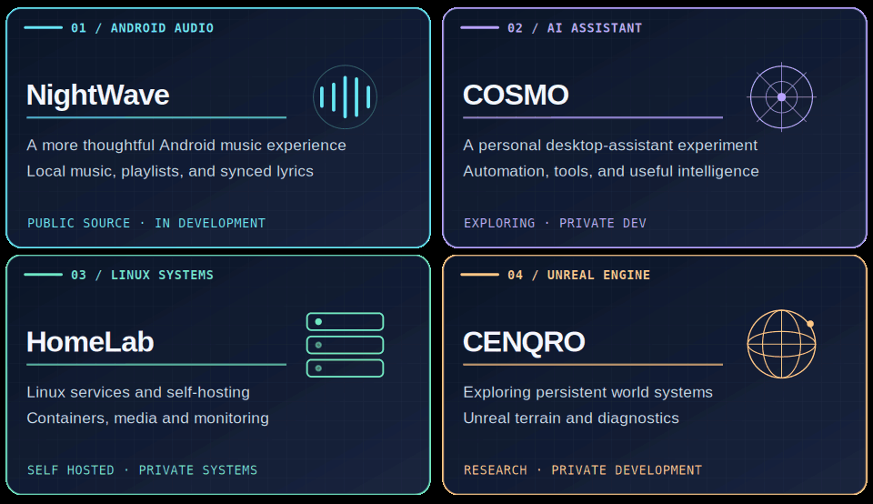
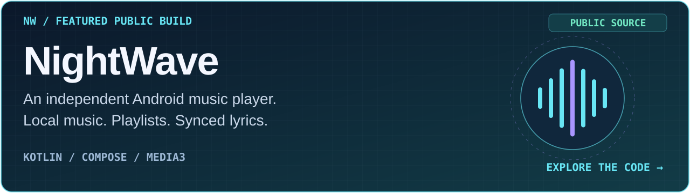
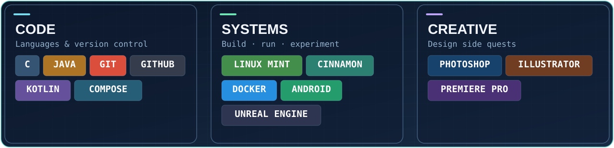

<!--
  THE PERSONAL LAB / PROFILE
  Curated engineering work. Project imagery is original and stored in /assets.
  Private research and infrastructure are summarized only at a high level.
-->

  <picture>
    <source media="(prefers-color-scheme: dark)" srcset="assets/hero-premium-dark.svg" />
    <source media="(prefers-color-scheme: light)" srcset="assets/hero-premium-light.svg" />
    
  </picture>

  

    <a href="https://portfolio.jayednahian2002.workers.dev/">PORTFOLIO</a>
    &nbsp; · &nbsp;
    <a href="https://github.com/Nahian2002/NightWave">NIGHTWAVE</a>
    &nbsp; · &nbsp;
    <a href="https://github.com/Nahian2002/NightWave/discussions">DISCUSSIONS</a>
    &nbsp; · &nbsp;
    <a href="https://www.linkedin.com/in/jayed-al-nahian-2a5ab3248/">LINKEDIN</a>
  

  COMPUTER SCIENCE & ENGINEERING · DHAKA, BANGLADESH · BUILD / TEST / REFINE

---

### 01 / THE ENGINEERING MINDSET

I'm **Jayed Al Nahian**, a CSE student at North South University. I like building real software, understanding the systems beneath it, and refining the small details that make a product feel right.

My work moves between **Android experiences, personal AI tooling, Linux infrastructure, and Unreal Engine research**. Some of it is open source; some remains private while I experiment and validate it.

**What matters to me:** intentional interfaces · reliable behavior · careful iteration · reproducible engineering.

### 02 / SELECTED SYSTEMS

  <picture>
    <source media="(max-width: 700px)" srcset="assets/featured-ultrasmooth-mobile.gif" />
    
  </picture>

Motion-rendered cards for GitHub · [Original scalable artwork](assets/featured-public-desktop.svg) · NightWave has public source; COSMO, HomeLab and CENQRO are private engineering projects or environments.

### 03 / FLAGSHIP PUBLIC BUILD

<a href="https://github.com/Nahian2002/NightWave">
  <picture>
    <source media="(max-width: 700px)" srcset="assets/showcase-nightwave-mobile.svg" />
    
  </picture>
</a>

**NightWave** is an independent Android audio project exploring considered UI, local playback, background listening, playlists, synchronized lyrics, and sound controls.

**Kotlin / Jetpack Compose / Media3 / Gradle** · Public source · Versioned APK releases

[Explore the source](https://github.com/Nahian2002/NightWave) &nbsp;·&nbsp; [Releases](https://github.com/Nahian2002/NightWave/releases) &nbsp;·&nbsp; [Build & QA notes](https://github.com/Nahian2002/NightWave/blob/main/docs/BUILD_AND_RELEASE.md) &nbsp;·&nbsp; [Contribute](https://github.com/Nahian2002/NightWave/blob/main/CONTRIBUTING.md)

<b>More of the engineering desk</b>

| Project | Engineering focus | Visibility |
| --- | --- | --- |
| **COSMO** | Python-based personal assistant, automation and device-oriented experiments | Private development |
| **CENQRO** | Unreal Engine world simulation and rendering diagnostics | Private research and diagnostics |
| **HomeLab** | Linux services, containers, reverse proxying and operational monitoring | Private infrastructure |
| **[Portfolio](https://portfolio.jayednahian2002.workers.dev/)** | Personal engineering showcase and motion-focused web experimentation | Live website |

The private project descriptions are intentionally high-level. Full source, configurations, devices, and runtime data are not published here.

### 04 / THE TOOLKIT

  <picture>
    <source media="(max-width: 700px)" srcset="assets/toolkit-nightwave-mobile.svg" />
    
  </picture>

Classic three-column toolkit restored. Also in current projects: Python, Media3, Gradle, Nginx, systemd, GitHub Actions and Cloudflare. The visual includes tools from earlier and current environments, not a claim of equal proficiency.

### 05 / PUBLIC WORK & COLLABORATION

- **[NightWave](https://github.com/Nahian2002/NightWave)** — main public Android build, release history and contributor documentation.
- **[Automated Reminder](https://github.com/Nahian2002/Automated-Reminder)** — Java Swing utility with persistence, automated smoke tests and CI.
- **[Fitness Tracker](https://github.com/Nahian2002/Fitness-Tracker---CSE215L)** — Java desktop coursework exploring multiple UI, service and data layers.

For product questions and ideas, use [NightWave Discussions](https://github.com/Nahian2002/NightWave/discussions). For reproducible defects, use [NightWave Issues](https://github.com/Nahian2002/NightWave/issues).

<b>Foundations & coursework archive</b>

Early learning repositories are preserved as part of my development history, rather than featured as flagship engineering work.

[Learning C](https://github.com/Nahian2002/Learning-C) · [Learning Java](https://github.com/Nahian2002/Learning-JAVA) · [CSE115L project](https://github.com/Nahian2002/CSE-115L-Project) · [Git 115 group project](https://github.com/Nahian2002/Git_115_Grp08)

[View the full repository index](PORTFOLIO_INDEX.md)

---

  
  
<a href="https://github.com/Nahian2002?tab=repositories">REPOSITORIES</a> &nbsp;·&nbsp; <a href="https://github.com/Nahian2002?tab=achievements">ACHIEVEMENTS</a> &nbsp;·&nbsp; <a href="https://portfolio.jayednahian2002.workers.dev/">PORTFOLIO</a>

  JAYED AL NAHIAN · CURIOSITY WITH A BUILD LOG

