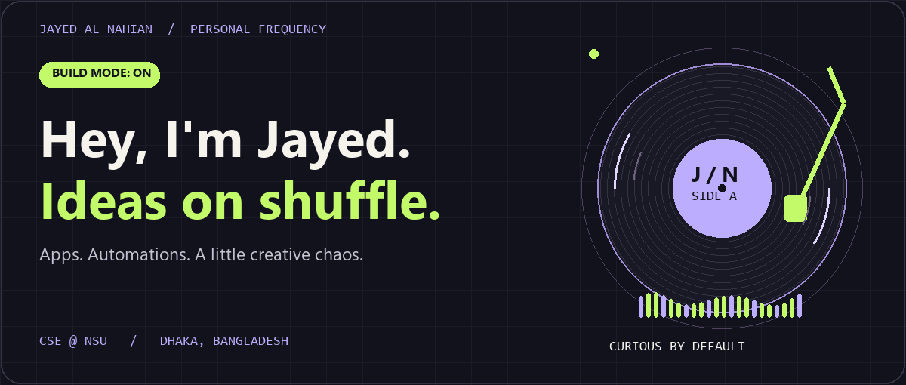
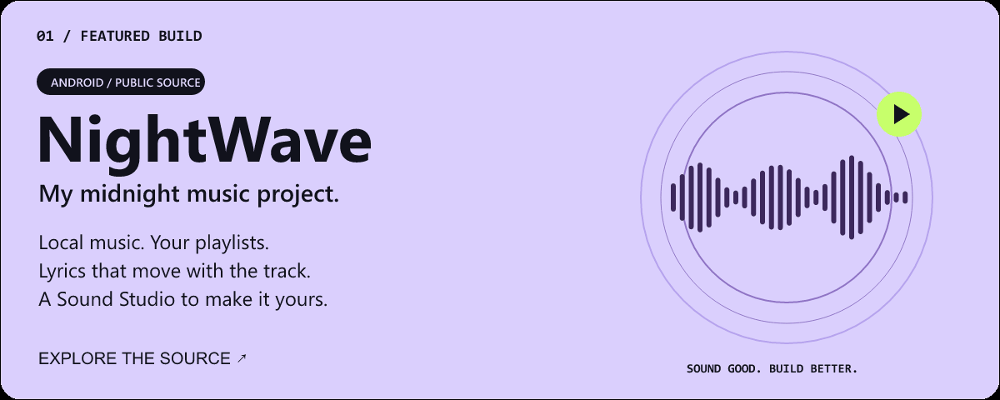
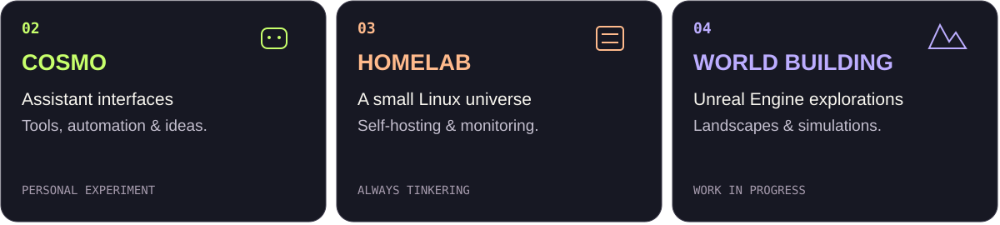
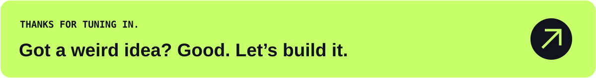

<!-- Original artwork lives in assets/on-air. Motion has local still-image fallbacks. -->

<picture>
  <source media="(prefers-reduced-motion: reduce) and (max-width: 700px)" srcset="assets/on-air/hero-mobile-still.png" />
  <source media="(prefers-reduced-motion: reduce)" srcset="assets/on-air/hero-still.png" />
  <source media="(max-width: 700px)" srcset="assets/on-air/hero-mobile.gif" />
  
</picture>

<p align="center">
  <a href="#-on-repeat-nightwave">🎧 Featured build</a> &nbsp; / &nbsp;
  <a href="#-the-other-channels">🛸 Other channels</a> &nbsp; / &nbsp;
  <a href="#-the-toolbox">🧰 Toolbox</a> &nbsp; / &nbsp;
  <a href="https://www.linkedin.com/in/jayed-al-nahian-2a5ab3248/">↗ Say hello</a>
</p>

### 👋 The human behind the commits

I'm **Jayed Al Nahian**, a **Computer Science & Engineering student at North South University**, based in **Dhaka, Bangladesh**. I like turning “what if?” into something I can actually use.

My projects live somewhere between **software, automation, and visual design**: Android apps, Linux services, assistant experiments, and Unreal Engine worlds. I care about how things feel to use as much as how they work underneath.

**Current rabbit holes:** music-player experiences · reliable self-hosting · AI assistants · world building.

### 🎧 On repeat: NightWave

<a href="https://github.com/Nahian2002/NightWave">
  <picture>
    <source media="(prefers-reduced-motion: reduce) and (max-width: 700px)" srcset="assets/on-air/nightwave-mobile.svg" />
    <source media="(prefers-reduced-motion: reduce)" srcset="assets/on-air/nightwave.svg" />
    <source media="(max-width: 700px)" srcset="assets/on-air/nightwave-mobile.gif" />
    
  </picture>
</a>

**An independent Android music player with an original midnight design.** This is where my interest in music, interface design, and engineering meets actual code.

- **Your library:** local audio, playlists, liked songs, folders, and listening history.
- **Keep the music going:** background playback, queues, shuffle, and repeat with Media3.
- **Make it yours:** imported synchronized lyrics, Sound Studio, and optional Google Drive backup.

**Built with:** Kotlin · Jetpack Compose · Android · Media3 · Room

**Status:** public source, actively in development. An APK release is still pending validation; the repository is the place to explore the work.

**[Explore NightWave →](https://github.com/Nahian2002/NightWave)** &nbsp; · &nbsp; [Build notes](https://github.com/Nahian2002/NightWave/blob/main/docs/BUILD_AND_RELEASE.md) &nbsp; · &nbsp; [What's next](https://github.com/Nahian2002/NightWave/blob/main/docs/PRODUCT_QUALITY_ROADMAP.md)

### 🛸 The other channels

<picture>
  <source media="(max-width: 700px)" srcset="assets/on-air/channels-mobile.svg" />
  
</picture>

**COSMO** is my playground for assistant interfaces and automation ideas. **HomeLab** is where I tinker with Linux Mint, Cinnamon, containers, media services, and monitoring. **World building** takes that curiosity into Unreal Engine landscapes and simulation concepts. These are personal explorations at different stages.

<details>
<summary><b>🗃️ Dig through the public code crate</b></summary>

The earlier builds are part of the story too — coursework, practice, and small experiments that helped me get here.

| Project | What's in the crate |
| :--- | :--- |
| [Fitness Tracker](https://github.com/Nahian2002/Fitness-Tracker---CSE215L) | Java coursework project |
| [Automated Reminder](https://github.com/Nahian2002/Automated-Reminder) | Java reminder experiments: daily, weekly, and custom |
| [Employee Management System](https://github.com/Nahian2002/CSE-115L-Project) | C programming coursework |
| [Learning Java](https://github.com/Nahian2002/Learning-JAVA) | Java practice and fundamentals |
| [Learning C](https://github.com/Nahian2002/Learning-C) | C practice and problem solving |
| [Group project archive](https://github.com/Nahian2002/Git_115_Grp08) | Early C coursework with a team |

</details>

### 🧰 The toolbox

| Channel | Tools I use & explore |
| :--- | :--- |
| **App building** | Kotlin · Jetpack Compose · Android · Java · C |
| **Systems & automation** | Linux Mint / Cinnamon · Docker · Git · GitHub |
| **Worlds & visuals** | Unreal Engine · Photoshop · Illustrator · Premiere Pro |

I learn by building, breaking, and improving things. The toolbox keeps growing with the projects.

<details>
<summary><b>🎮 Press START for the developer status screen</b></summary>

```text
PLAYER       Jayed
CLASS        Curious builder
MAIN QUEST   Make something useful. Make it feel good.
SIDE QUEST   One more feature. (There is always one.)
SAVE FILE    final_v7_revised_ACTUALLY_FINAL
BOSS FIGHT   It worked yesterday.

              [ BUILD → BREAK → LEARN → REPEAT ]
```

</details>

### 📡 Find me on the same frequency

I enjoy talking about Android apps, self-hosting, creative tools, and ambitious little ideas.

**[LinkedIn](https://www.linkedin.com/in/jayed-al-nahian-2a5ab3248/)** &nbsp; · &nbsp; **[X](https://x.com/Jayed_Al_Nahian)** &nbsp; · &nbsp; **[Facebook](https://www.facebook.com/jayed.al.nahian.2002/)** &nbsp; · &nbsp; **[Discord](https://discordapp.com/users/743125182889328653)** &nbsp; · &nbsp; [All public repositories ↗](https://github.com/Nahian2002?tab=repositories)

<a href="https://www.linkedin.com/in/jayed-al-nahian-2a5ab3248/">
  <picture>
    <source media="(max-width: 700px)" srcset="assets/on-air/footer-mobile.svg" />
    
  </picture>
</a>
