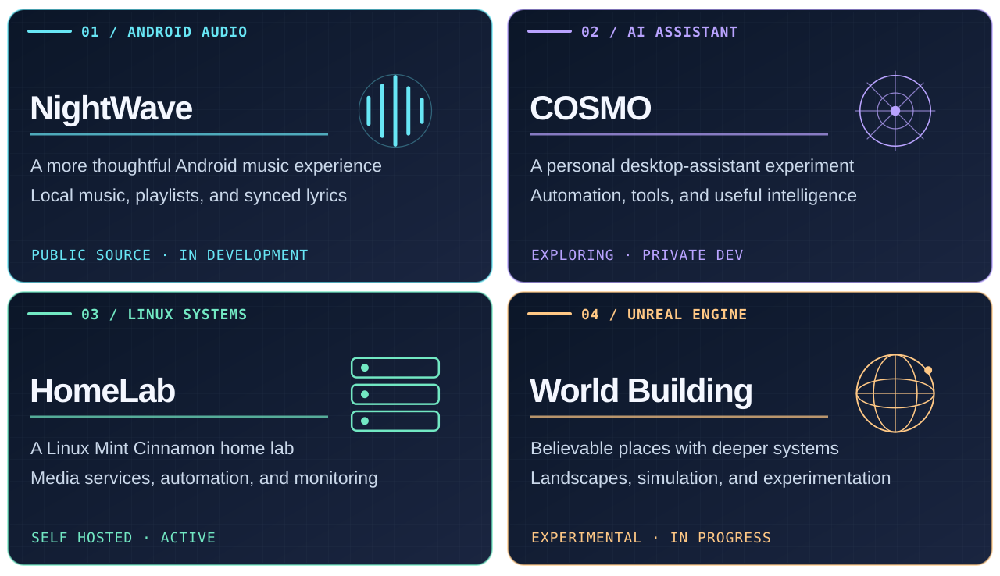
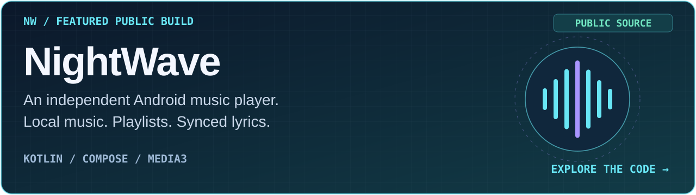
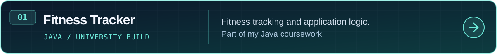
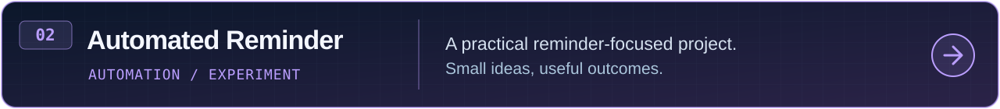
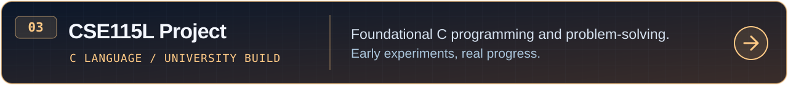
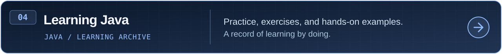
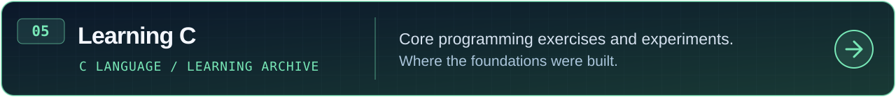
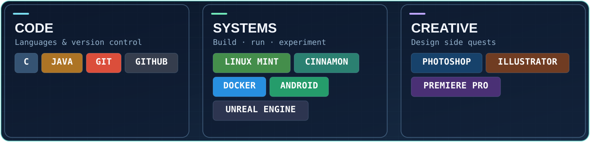

<!--
  JAYED AL NAHIAN / THE PERSONAL LAB
  Personal Lab: original theme preserved; public NightWave spotlight added.
  All project imagery is original and stored in /assets.
  Live typing + streak are third-party services and may occasionally be delayed.
-->

<div align="center">
  <picture>
    <source media="(prefers-color-scheme: dark)" srcset="assets/hero-premium-dark.svg" />
    <source media="(prefers-color-scheme: light)" srcset="assets/hero-premium-light.svg" />
    
  </picture>

  <a href="https://github.com/Nahian2002">
    
  </a>

  <p>
    <a href="https://www.linkedin.com/in/jayed-al-nahian-2a5ab3248/"></a>
    <a href="https://x.com/Jayed_Al_Nahian"></a>
    <a href="https://www.facebook.com/jayed.al.nahian.2002/"></a>
    <a href="https://discordapp.com/users/743125182889328653"></a>
  </p>

  <sub>📍 Dhaka, Bangladesh &nbsp; · &nbsp; 🎓 CSE @ North South University &nbsp; · &nbsp; ⚡ Curious by default</sub>
</div>

---

### 👾 THE PERSON BEHIND THE TERMINAL

I'm **Jayed Al Nahian**, a Computer Science & Engineering student who enjoys turning *"what if?"* into *"it actually works."*

I build things for the fun of figuring them out: Android apps, Linux services, automations, ambitious game-world ideas, and the occasional wildly unnecessary experiment.

**Currently obsessed with:** seamless app experiences · reliable self-hosting · AI assistants · Unreal Engine environments.

**🎧 Now building in public:** [NightWave](https://github.com/Nahian2002/NightWave), my independent Android music player. [Explore the source →](https://github.com/Nahian2002/NightWave)

<div align="center">
  
</div>

### 🪐 FEATURED EXPERIMENTS

<sub>NightWave is now public. COSMO, HomeLab, and world building are personal explorations at different stages.</sub>

<div align="center">
  <picture>
    <source media="(max-width: 700px)" srcset="assets/featured-mobile.svg" />
    
  </picture>
</div>

<details>
<summary><b>🔎 What's inside these experiments?</b></summary>

**🎧 [NightWave](https://github.com/Nahian2002/NightWave):** Public Android music-player source: local music, playlists, imported synchronized lyrics, and Sound Studio. Still in development.

**🤖 COSMO:** Assistant interfaces, tool integration, and automation ideas.

**🖥️ HomeLab:** Linux Mint with Cinnamon, containers, home media services, and monitoring.

**🌌 World Building:** Unreal Engine landscapes and persistent simulation concepts.

</details>

<details>
<summary><b>🕹️ Open the lab's secret status panel</b></summary>
<br/>

```text
┌─ JAYED / ENGINEERING LAB ─────────────────┐
│ curiosity.exe              ● RUNNING     │
│ one-more-feature.service   ● ENABLED     │
│ bugs                       ◐ INVESTIGATING
│ sleep-schedule             ? UNKNOWN     │
│ final_version              404 NOT FOUND │
└───────────────────────────────────────────┘

> make something.
> break something.
> learn something.
> repeat forever.
```

</details>

### 🚀 OPEN-SOURCE & PUBLIC CODE

<sub>NightWave leads the public builds below, alongside my earlier coursework and coding experiments. Tap any card to explore the code.</sub>

<a href="https://github.com/Nahian2002/NightWave">
  <picture>
    <source media="(max-width: 700px)" srcset="assets/showcase-nightwave-mobile.svg" />
    
  </picture>
</a>

**🎧 NightWave** brings together my interests in music, interface design, and Android development. The source includes local playback, playlists, imported synchronized lyrics, Sound Studio, and optional Google Drive backup.

**[Explore the source →](https://github.com/Nahian2002/NightWave)** · [Build notes](https://github.com/Nahian2002/NightWave/blob/main/docs/BUILD_AND_RELEASE.md) · [What's next](https://github.com/Nahian2002/NightWave/blob/main/docs/PRODUCT_QUALITY_ROADMAP.md)

<sub>Public source · In development · An APK release is still pending validation.</sub>

<br/><br/>

<div align="center">

  <a href="https://github.com/Nahian2002/Fitness-Tracker---CSE215L">
    <picture>
      <source media="(max-width: 700px)" srcset="assets/showcase-fitness-mobile.svg" />
      
    </picture>
  </a>

  <a href="https://github.com/Nahian2002/Automated-Reminder">
    <picture>
      <source media="(max-width: 700px)" srcset="assets/showcase-reminder-mobile.svg" />
      
    </picture>
  </a>

  <a href="https://github.com/Nahian2002/CSE-115L-Project">
    <picture>
      <source media="(max-width: 700px)" srcset="assets/showcase-cse115l-mobile.svg" />
      
    </picture>
  </a>

  <a href="https://github.com/Nahian2002/Learning-JAVA">
    <picture>
      <source media="(max-width: 700px)" srcset="assets/showcase-java-mobile.svg" />
      
    </picture>
  </a>

  <a href="https://github.com/Nahian2002/Learning-C">
    <picture>
      <source media="(max-width: 700px)" srcset="assets/showcase-c-mobile.svg" />
      
    </picture>
  </a>

</div>

<details>
<summary><b>🗂️ Prefer ordinary text links? Open the project index</b></summary>

- [NightWave — Android music player, public source](https://github.com/Nahian2002/NightWave)
- [Fitness Tracker — Java coursework](https://github.com/Nahian2002/Fitness-Tracker---CSE215L)
- [Automated Reminder — coding experiment](https://github.com/Nahian2002/Automated-Reminder)
- [CSE115L — C programming coursework](https://github.com/Nahian2002/CSE-115L-Project)
- [Learning Java — practice archive](https://github.com/Nahian2002/Learning-JAVA)
- [Learning C — practice archive](https://github.com/Nahian2002/Learning-C)

</details>

<div align="right">
  <a href="https://github.com/Nahian2002?tab=repositories"><b>Browse all public repositories →</b></a>
</div>

### 🧰 THE TOOLKIT

<div align="center">
  <picture>
    <source media="(max-width: 700px)" srcset="assets/toolkit-mobile.svg" />
    
  </picture>
</div>

<sub>Tools I use and explore — not claims of mastery. Linux Mint with the Cinnamon desktop is my current home lab environment.</sub>

### ⚡ THE LIVE SIGNAL

<div align="center">
  <a href="https://github.com/Nahian2002">
    
  </a>
  <br/>
  <sub>Live GitHub streak · Third-party stats can occasionally lag behind GitHub.</sub>
</div>

<details>
<summary><b>📡 Explore the activity logs</b></summary>
<br/>

- [My contribution calendar](https://github.com/Nahian2002)
- [Repositories & latest code](https://github.com/Nahian2002?tab=repositories)
- [Public activity](https://github.com/Nahian2002?tab=overview)

</details>

### 🧪 ONE MORE THING...

```java
while (curiosity > fearOfBugs) {
    buildSomething();
    learnSomething();
    tryAgain();
}
```

<details>
<summary><b>🥚 You found an easter egg</b></summary>
<br/>

**Developer:** This is the final version.

**Git:** `final_v7_revised_ACTUALLY_FINAL`

**Developer:** ...I have one more idea.

</details>

---

<div align="center">
  
  <p>
    <a href="https://github.com/Nahian2002?tab=repositories"></a>
    <a href="https://www.linkedin.com/in/jayed-al-nahian-2a5ab3248/"></a>
  </p>
  <sub>JAYED AL NAHIAN · CURIOUS BY DEFAULT · ALWAYS ITERATING</sub>
</div>
