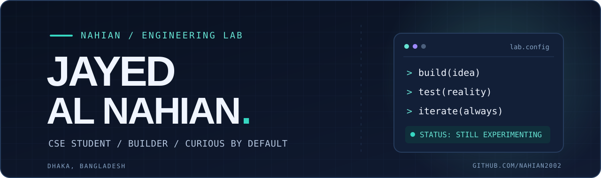

<!--
  GitHub profile README for github.com/Nahian2002
  Original engineering-lab design. Visuals are hosted in this repository.
-->

  <picture>
    <source media="(prefers-color-scheme: dark)" srcset="assets/hero-dark.svg" />
    <source media="(prefers-color-scheme: light)" srcset="assets/hero-light.svg" />
    
  </picture>

  
<strong>Building software, tinkering with systems, and exploring what's possible.</strong>

  

    <a href="https://www.linkedin.com/in/jayed-al-nahian-2a5ab3248/">LinkedIn</a>
    &nbsp;·&nbsp;
    <a href="https://x.com/Jayed_Al_Nahian">X / Twitter</a>
    &nbsp;·&nbsp;
    <a href="https://www.facebook.com/jayed.al.nahian.2002/">Facebook</a>
    &nbsp;·&nbsp;
    <a href="https://github.com/Nahian2002?tab=repositories">Repositories ↗</a>
  

---

### 01 / A bit about me

I'm **Jayed**, a Computer Science & Engineering student at **North South University** in Dhaka, Bangladesh.

I like taking ideas beyond the tutorial stage: making an app feel right, keeping a Linux service alive, automating something repetitive, or figuring out why a system doesn't behave as expected. Sometimes that means writing code. Sometimes it means spending far too long debugging it.

> **Build → test → break → understand → improve.** That's usually the process.

### 02 / On my workbench

<table>
  <tr>
    <td width="50%" valign="top">
      <strong>📱 Apps &amp; interfaces</strong> 
      Exploring Android experiences, UI details, playback systems, and practical web applications.
    </td>
    <td width="50%" valign="top">
      <strong>🖥️ Systems &amp; automation</strong> 
      Linux services, Docker, self-hosting, small tools, and automations that solve real problems.
    </td>
  </tr>
  <tr>
    <td width="50%" valign="top">
      <strong>🤖 AI &amp; experiments</strong> 
      Assistant interfaces, local-first ideas, and software that's useful beyond a demo.
    </td>
    <td width="50%" valign="top">
      <strong>🌍 Interactive worlds</strong> 
      Unreal Engine environments, simulation concepts, and the systems behind believable worlds.
    </td>
  </tr>
</table>

<b>↳ A few projects currently in the lab</b>

- **NightWave** — experimenting with an Android music-listening experience.
- **COSMO** — exploring a desktop assistant and its surrounding tools.
- **Unreal Engine experiments** — environments, terrain, and persistent simulation concepts.
- **Homelab projects** — media services, monitoring, and day-to-day automation.

These are ongoing experiments; some repositories are private or not ready for a public release.

### 03 / Public builds

A few repositories from my coding journey, from foundational coursework to useful small experiments:

| Project | Focus | What it is |
| :--- | :--- | :--- |
| [**Fitness Tracker**](https://github.com/Nahian2002/Fitness-Tracker---CSE215L) | `Java` | A fitness-tracking project created as part of my CSE215L coursework. |
| [**CSE-115L Project**](https://github.com/Nahian2002/CSE-115L-Project) | `C` | A C programming coursework repository. |
| [**Automated Reminder**](https://github.com/Nahian2002/Automated-Reminder) | `Experiment` | A small reminder-focused coding project. |

Not everything I build is on GitHub yet. The public repositories are snapshots of the learning process, not a claim that every prototype is finished.

### 04 / My toolkit

| Area | Tools & interests |
| :--- | :--- |
| **Programming fundamentals** | `C` · `Java` · problem-solving |
| **Systems** | `Linux / Debian` · `Docker` · `Git` · self-hosted services |
| **Building & exploring** | `Android` · `Unreal Engine 5` · web applications · automation |
| **Creative tools** | `Photoshop` · `Illustrator` · `Premiere Pro` |

I enjoy learning by making things, not collecting technology logos.

### 05 / Stay connected

If you like software experiments, systems tinkering, or watching projects evolve, you're in the right place.

**[Explore my repositories](https://github.com/Nahian2002?tab=repositories)** · **[Connect on LinkedIn](https://www.linkedin.com/in/jayed-al-nahian-2a5ab3248/)** · **[Find me on X](https://x.com/Jayed_Al_Nahian)**

  DESIGNED TO EVOLVE · MADE WITH CURIOSITY, NOT A TEMPLATE

