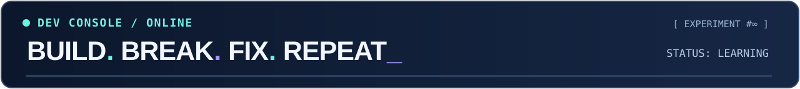
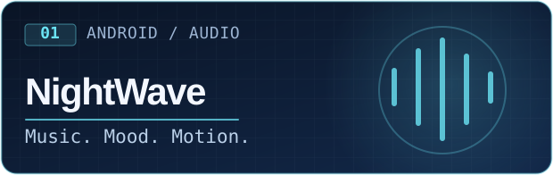
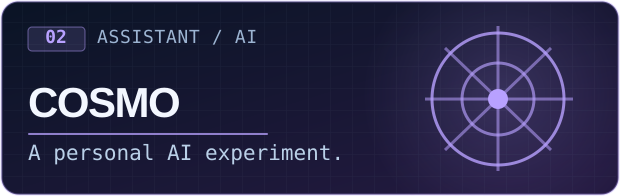
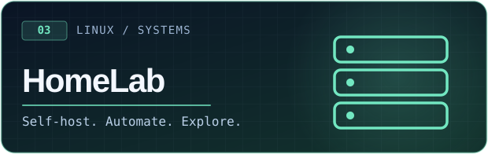
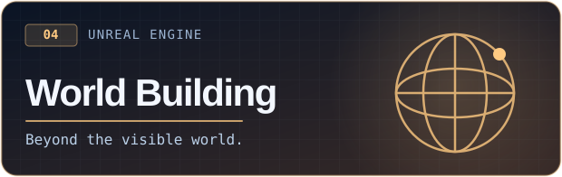

<!--
  JAYED AL NAHIAN / THE PERSONAL LAB
  Premium profile v4: original local SVG art; fun elements preserved.
  All project imagery is original and stored in /assets.
  Live typing + streak are third-party services and may occasionally be delayed.
-->

<div align="center">
  <picture>
    <source media="(prefers-color-scheme: dark)" srcset="assets/hero-premium-dark.svg" />
    <source media="(prefers-color-scheme: light)" srcset="assets/hero-premium-light.svg" />
    
  </picture>

  <a href="https://github.com/Nahian2002">
    
  </a>

  <p>
    <a href="https://www.linkedin.com/in/jayed-al-nahian-2a5ab3248/"></a>
    <a href="https://x.com/Jayed_Al_Nahian"></a>
    <a href="https://www.facebook.com/jayed.al.nahian.2002/"></a>
    <a href="https://discordapp.com/users/743125182889328653"></a>
  </p>

  <sub>📍 Dhaka, Bangladesh &nbsp; · &nbsp; 🎓 CSE @ North South University &nbsp; · &nbsp; ⚡ Curious by default</sub>
</div>

---

### 👾 THE PERSON BEHIND THE TERMINAL

I'm **Jayed Al Nahian**, a Computer Science & Engineering student who enjoys turning *"what if?"* into *"it actually works."*

I build things for the fun of figuring them out: Android apps, Linux services, automations, ambitious game-world ideas, and the occasional wildly unnecessary experiment.

**Currently obsessed with:** seamless app experiences · reliable self-hosting · AI assistants · Unreal Engine environments.

<div align="center">
  
</div>

### 🪐 FEATURED EXPERIMENTS

<sub>Four corners of my workbench. Some are private or actively evolving — these aren't advertised as finished releases.</sub>

<table>
<tr>
<td width="50%" valign="top">
  
  <p>🎧 <strong>NightWave</strong><br/>Building a more thoughtful Android music experience, from playback behavior to a polished interface.</p>
  <sub>ANDROID · PERSONAL EXPERIMENT</sub>
</td>
<td width="50%" valign="top">
  
  <p>🤖 <strong>COSMO</strong><br/>Exploring an assistant that connects useful tools, automation, and persistent intelligence.</p>
  <sub>DESKTOP · PERSONAL EXPERIMENT</sub>
</td>
</tr>
<tr>
<td width="50%" valign="top">
  
  <p>🖥️ <strong>HomeLab & Automation</strong><br/>A Debian-powered playground of services, media tools, monitoring, and automation.</p>
  <sub>LINUX · SELF-HOSTED</sub>
</td>
<td width="50%" valign="top">
  
  <p>🌌 <strong>Worlds & Simulation</strong><br/>Experimenting with Unreal Engine landscapes, believable environments, and deeper world systems.</p>
  <sub>UNREAL ENGINE · EXPLORATORY</sub>
</td>
</tr>
</table>

<details>
<summary><b>🕹️ Open the lab's secret status panel</b></summary>
<br/>

```text
┌─ JAYED / ENGINEERING LAB ─────────────────┐
│ curiosity.exe              ● RUNNING     │
│ one-more-feature.service   ● ENABLED     │
│ bugs                       ◐ INVESTIGATING
│ sleep-schedule             ? UNKNOWN     │
│ final_version              404 NOT FOUND │
└───────────────────────────────────────────┘

> make something.
> break something.
> learn something.
> repeat forever.
```

</details>

### 🚀 OPEN-SOURCE & PUBLIC CODE

Not every experiment is public yet. These are real repositories you can explore:

<table>
<tr>
<td width="50%" valign="top">
<strong><a href="https://github.com/Nahian2002/Fitness-Tracker---CSE215L">💪 Fitness Tracker ↗</a></strong><br/>
<sub>Java · University project</sub><br/>
Coursework focused on fitness tracking and application logic.
</td>
<td width="50%" valign="top">
<strong><a href="https://github.com/Nahian2002/Automated-Reminder">⏰ Automated Reminder ↗</a></strong><br/>
<sub>Automation · Experiment</sub><br/>
A small reminder-focused coding experiment.
</td>
</tr>
<tr>
<td width="50%" valign="top">
<strong><a href="https://github.com/Nahian2002/CSE-115L-Project">⚙️ CSE115L Project ↗</a></strong><br/>
<sub>C · University project</sub><br/>
An earlier C programming and problem-solving project.
</td>
<td width="50%" valign="top">
<strong><a href="https://github.com/Nahian2002/Learning-JAVA">☕ Java</a> / <a href="https://github.com/Nahian2002/Learning-C">🧩 C ↗</a></strong><br/>
<sub>Learning archive</sub><br/>
Exercises, fundamentals, and practice projects.
</td>
</tr>
</table>

<div align="right"><a href="https://github.com/Nahian2002?tab=repositories"><b>Browse all public repositories →</b></a></div>

### 🧰 THE TOOLKIT

<table>
<tr>
<td width="25%" valign="middle"><strong>⌘ Code</strong><br/><sub>Languages &amp; version control</sub></td>
<td width="75%" valign="middle">


</td>
</tr>
<tr>
<td width="25%" valign="middle"><strong>⚙ Systems</strong><br/><sub>Build · run · experiment</sub></td>
<td width="75%" valign="middle">


</td>
</tr>
<tr>
<td width="25%" valign="middle"><strong>✦ Creative</strong><br/><sub>Design side quests</sub></td>
<td width="75%" valign="middle">


</td>
</tr>
</table>

<sub>Tools I use or explore, rather than claims of mastery.</sub>

### ⚡ THE LIVE SIGNAL

<div align="center">
  <a href="https://github.com/Nahian2002">
    
  </a>
  <br/>
  <sub>Live GitHub streak · Third-party stats can occasionally lag behind GitHub.</sub>
</div>

<details>
<summary><b>📡 Explore the activity logs</b></summary>
<br/>

- [My contribution calendar](https://github.com/Nahian2002)
- [Repositories & latest code](https://github.com/Nahian2002?tab=repositories)
- [Public activity](https://github.com/Nahian2002?tab=overview)

</details>

### 🧪 ONE MORE THING...

```java
while (curiosity > fearOfBugs) {
    buildSomething();
    learnSomething();
    tryAgain();
}
```

<details>
<summary><b>🥚 You found an easter egg</b></summary>
<br/>

**Developer:** This is the final version.

**Git:** `final_v7_revised_ACTUALLY_FINAL`

**Developer:** ...I have one more idea.

</details>

---

<div align="center">
  
  <p>
    <a href="https://github.com/Nahian2002?tab=repositories"></a>
    <a href="https://www.linkedin.com/in/jayed-al-nahian-2a5ab3248/"></a>
  </p>
  <sub>JAYED AL NAHIAN · CURIOUS BY DEFAULT · ALWAYS ITERATING</sub>
</div>
